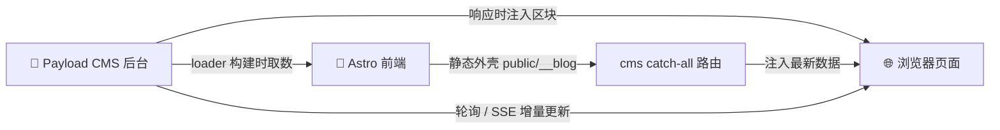

<div align="center">

# ☁️ cloud-blog · 云岫的博客

**一个「前台 + 后台」双应用的 Monorepo** — 用 Astro 🌠 做站点，用 Payload CMS 💼 管内容。


**✨ 一条命令搞定发布 ✨**

</div>

---

## 🌱 项目来源与致谢

> [!IMPORTANT]
> 本项目不是从零开始写的，它站在两个开源项目之上。**代码与素材的来龙去脉如下，请一并遵守其许可。**

| 🙏 项目                                                                        | 关系                                                                                                                                                                                                                                                               | 许可       |
| ------------------------------------------------------------------------------ | ------------------------------------------------------------------------------------------------------------------------------------------------------------------------------------------------------------------------------------------------------------------ | ---------- |
| [**clay-blog**](https://github.com/laogou717/clay-blog)（神烦老狗）            | **前台基底**：`apps/blog` 的 Astro 骨架、组件与样式源自它，本项目在其上大幅重构（内容全部改由 Payload 提供、加实时同步、重做页面与版式）                                                                                                                           | MIT ✅     |
| [**ThriveX-Blog**](https://github.com/LiuYuYang01/ThriveX-Blog)（LiuYuYang01） | **版式与交互参考**：后台卡片式外壳、两级缩进导航、标签页记忆、数据概览页与部分前台布局，均参考其设计后自行实现（**未复制其源代码**）；外加**一张静态素材**——页脚动物插画 `apps/blog/public/images/footer-animals.png` 与其 `Footer/images/animals.webp` 为同一文件 | GPL-3.0 ⚠️ |

- `apps/cms`（Payload CMS 后台）为本项目自行编写，基于 Payload 官方脚手架模板。
- 因为包含了 ThriveX 的 GPL-3.0 素材（页脚插画），**本仓库整体按 GPL-3.0 发布**，而不是前台基底原本的 MIT。
- 完整的第三方来源、署名与许可全文见 **[THIRD-PARTY-NOTICES.md](THIRD-PARTY-NOTICES.md)**。

---

## 🧬 仓库速览

两个应用相互独立、各自带 `package.json` 与 lockfile；**部署时作为同一个 EdgeOne Makers 项目**（根目录 `apps/cms`）一起上线，前后台同域名：

| 📦 目录     | 🚀 应用  | 🧰 技术栈                        | 💡 说明                                                                     |
| ----------- | -------- | -------------------------------- | --------------------------------------------------------------------------- |
| `apps/blog` | 博客前端 | 🌠 Astro 7（静态站）             | 文章 / 随笔 / 归档 / 搜索 / RSS / 关于页，构建时从后台拉取内容              |
| `apps/cms`  | 内容后台 | 💼 Payload CMS 3.91 + Next.js 16 | 文章 / 随笔 / 项目 / 分类标签 / 站点设置 / 导航管理，是内容的**唯一数据源** |

```
cloud/
├── 📦 apps/
│   ├── 🌠 blog/                    # 博客前端（源自 clay-blog）
│   │   ├── astro.config.mjs                    # Astro 配置（含 payload-hot-reload）
│   │   ├── src/                                # 页面 / 组件 / content collections / 样式
│   │   │   ├── content.config.ts               # posts / notes / projects 集合定义
│   │   │   └── lib/
│   │   │       ├── payload-api.ts              # 后台 REST 客户端（文章/随笔/项目/设置/导航）
│   │   │       ├── payload-loader.ts           # Astro loader：从后台载入并轮询变化
│   │   │       ├── site-defaults.ts            # 站点默认值（后台缺失时兜底）
│   │   │       ├── site-settings.ts            # 从后台读取站点设置
│   │   │       └── posts.ts                    # 站点信息与文章排序等工具
│   │   ├── public/                             # 静态资源（含页脚插画：来自 ThriveX，见来源说明）
│   │   ├── patches/                            # astro 本地开发补丁（中文路径编码）
│   │   ├── package.json                        # 独立依赖 + lockfile
│   │   ├── .env.example                        # 站点环境变量示例
│   │   └── README.md                           # 博客使用说明
│   └── 💼 cms/                     # → EdgeOne Makers 项目（后台 + 托管前台产物）
│       ├── src/payload.config.ts               # Payload 主配置
│       ├── src/collections/                    # Posts / Notes / Projects / Categories / Tags / Media / Users
│       ├── src/globals/                        # SiteSettings / Navigation
│       ├── src/lib/                            # blog-render（区块渲染）/ blog-sync（数据同步）/ sync-cache
│       ├── src/app/api/                        # blog-sync（版本探测+全量区块）/ blog-sync/stream（SSE）
│       ├── src/app/[[...path]]/route.ts        # catch-all：返回静态外壳并注入最新数据
│       ├── src/migrations/                     # Postgres 迁移（含 projects 集合）
│       ├── next.config.mjs
│       ├── scripts/                            # copy-blog-to-public / prerender-blog-shells / verify-* / pg 启停 / warmup 等
│       ├── src/lib/render/                     # 服务端渲染层：按页面拆分的区块渲染器（门面是 src/lib/blog-render.tsx）
│       ├── package.json                        # 独立依赖 + lockfile
│       └── tsconfig.json
├── 📦 shared/                       # 跨应用共享模块（html-safety / post-utils / remark-rehype 插件等）
├── 📄 package.json                # 根编排脚本（唯一 devDependency：prettier），exports 暴露 ./shared/*
├── 📌 .gitignore
├── 🎨 .prettierrc.json / .editorconfig   # 格式化规则（两端同源，编辑器与 CLI 结果一致）
├── 🤖 .github/workflows/ci.yml    # 提交门禁：typecheck ×2 + 注入断言 + 格式检查
├── 📚 docs/adr/                   # 架构决策记录（唯一允许入库的 docs 子目录）
├── 📜 LICENSE                      # GPL-3.0 全文
└── 🙏 THIRD-PARTY-NOTICES.md       # 第三方来源与署名（clay-blog / ThriveX）
```

> `shared/` 的接线方式：两个应用都在各自 `package.json` 里声明依赖 `"cloud-blog": "file:../.."`
> （指回根包），再通过根包 `exports` 的 `./shared/*` 子路径导入，如 `import { ... } from 'cloud-blog/shared/html-safety'`。

---

## 🏗️ 内容架构

> [!IMPORTANT]
> 写博客的**所有内容都放进后台**，前台**不再维护本地 Markdown / JSON 数据**。

- 🗄️ **数据源**：`apps/cms` 的 Payload 集合是唯一事实来源 — 文章（Posts）、随笔（Notes）、项目（Projects）、分类（Categories）、标签（Tags），外加两个全局：站点设置（SiteSettings）与导航（Navigation）。
- 📡 **前台取数**：`apps/blog` 通过 Astro content loader（`payload-loader.ts`）在构建 / 开发时从后台 REST API 拉取 posts / notes / projects；站点名称、描述、作者在后台缺失时回退到 `lib/site-defaults.ts` 的默认值。
- 🧩 **关于页项目**：开源项目与资源下载卡片全部来自后台 `projects` 集合（按 `group` 分组聚合），不再依赖 GitHub API 构建时抓取或本地缓存 JSON。
- 🔥 **首屏就是最新数据**：`apps/cms` 的 catch-all 路由（`src/app/[[...path]]/route.ts`）在返回 HTML 前，会用 `blog-render` 按后台最新数据渲染区块并**直接注入静态外壳**，所以打开页面不会先闪一下构建时的旧内容。博客 HTML 单独放在 `apps/cms/public/__blog/`（不能摊在 `public/` 根下，否则会被静态托管直接命中、绕过注入）。
- 🔁 **页面打开后继续同步**：后台数据变更后，已打开的页面通过轮询（`/api/blog-sync?version=1` 版本探测 + 全量区块，SSE `/api/blog-sync/stream` 亦可）局部替换带 `data-sync-block` 锚点的区块；站点图标、歌单等**运行时值**随同一次响应下发，由前台脚本直接应用。服务端已注入过的区块带 `data-sync-version`，版本一致时客户端不会重复改写 DOM。
- 🧱 **外壳缺失有模板兜底**：新增文章在静态产物里还没有对应 HTML 时，按「同形模板外壳」即时渲染，不会 404。

> [!IMPORTANT]
> 区块约定：`blog-render` 里每个渲染函数返回的是**锚点元素的 innerHTML**（不含外层容器），
> 与 `*.astro` 模板中 `<xxx data-sync-block="id">` 一一对应。若返回里再带一层同名容器，
> 每次同步都会多套一层（双层边框/内边距）。



---

## 🚀 本地开发

> [!IMPORTANT]
> **本地开发默认连的是**线上 Supabase** Postgres 库（`apps/cms/.env.local` 已配好），
> 与生产共用同一个数据库 —— 这是有意设计，不是失误：本地看到的内容/评论就是线上真实数据。
> 因此：
>
> - **直接 `npm run dev:cms` 起后台即可，无需本地 PG**（本地绿色版 PG 的 `dev:cms:warm` 仍保留，
>   但需要本机装好 `D:\pglocal`，默认路径未安装时不要用它）。
> - 本地改动（后台改文案、发文章、评论、建标签）**会直接写进线上库**，前台轮询也会把线上改动拉进本地，属正常现象。
> - 评论服务（`/api/waline`）同样指向线上 Supabase：`.env.local` 里除 `POSTGRES_URL`（给 Payload）
>   外还配了 Waline 用的拆分变量组（`POSTGRES_HOST/PORT/USER/PASSWORD/DATABASE` + `POSTGRES_PREFIX=wl_` +
>   `POSTGRES_SSL=true`），表 `wl_comment / wl_counter / wl_users` 已在线上 `public` schema 就位。

### 快速开始（连线上库）

```bash
# 🛠️ 首次：安装两个应用的依赖
npm run setup

# 🖥️ 终端 1：博客前端 → http://localhost:3000
npm run dev:blog

# 🗄️ 终端 2：内容后台（直连线上 Supabase）→ http://localhost:9527
npm run dev:cms
```

> 起 CMS 后首次访问后台页面（`/admin`）会触发 Turbopack 冷编译，可能 30–60s 才返回 200；
> 评论/同步接口（`/api/blog-sync`、`/api/waline/api/comment`）首请求也会编译一遍，重试即正常。
> 建议先跑 `npm run dev:proxy`（端口 4321，同源代理）把 SSE/评论的同源行为验证掉。

### 可选：本地独立 Postgres（绿色版）

若你想让本地与线上**物理隔离**（避免误写线上数据），可改用本地 `D:\pglocal` 绿色版 PG：

```bash
# 起本地 PG + 后台（端口 5433，库 blog_dev）
npm run dev:cms:warm     # 按需启停 PG，零常驻；首次需手动 import schema（见 apps/cms/scripts/waline/schema.sql）
# 或不起预热
npm run dev:local --prefix apps/cms
```

- 本地 PG 需要自备 `waline_user` 角色与 `waline.wl_*` 表结构（`apps/cms/scripts/waline/README.md` 有说明）；
  不装本地 PG 就走上面的线上库模式。
- ⚠️ 本地 PG 模式下 Waline 的拆分变量回落 `.env`（`127.0.0.1:5433` + `waline_user`），与 Payload 的
  `POSTGRES_URL`（仍指向 Supabase）各走各的；两套连接的 schema 前缀都是 `wl_`，但表所在的
  search_path 不同（本地 `waline` schema，线上 `public` schema），按 README 建对应表即可。

### 通用说明

- 📡 前端构建/开发时从后台 API（`PUBLIC_PAYLOAD_URL`，默认 `http://localhost:9527`）拉取内容；**后台未运行时文章/随笔/项目为空**，但页面仍可正常访问（站点默认值兜底）。
- ⚡ 开发期后台数据变更会热同步到前台页面（`payload-hot-reload`：loader 检测变化后 touch 标记文件并广播整页刷新；生产走 SSE + 轮询）。
- 🔀 需要**同源 `/api/*`**（验证评论、SSE 等依赖同源的行为）时，用 `npm run dev:proxy`：它会在 `4321` 起一个代理并把 Astro 一并拉起；纯 UI 调试跑 `dev:blog` 单进程即可。

---

## 🗝️ 环境变量

`apps/blog/.env`（参考 `apps/blog/.env.example`）：

| 🎛️ 变量                                           | 💡 用途                                                                               |
| ------------------------------------------------- | ------------------------------------------------------------------------------------- |
| `SITE_URL`                                        | 站点正式域名（RSS / sitemap / canonical），构建时写入静态产物                         |
| `PUBLIC_PAYLOAD_URL`                              | Payload 后台地址，本地默认 `http://localhost:9527`；线上填**真实域名**（不带 `/api`） |
| `PUBLIC_WALINE_URL`                               | 💬 Waline 评论服务地址；留空默认同域 `/api/waline`（前后台同域部署无需配置）          |
| `PUBLIC_NETEASE_PLAYLIST_ID` / `PUBLIC_MUSIC_API` | 🎵 音乐播放器歌单                                                                     |

> 前台取数地址的优先级：`PUBLIC_PAYLOAD_URL` → `SITE_URL`（一体化部署前后台同域）→ `http://localhost:9527`。

`apps/cms` 环境变量（复制 `apps/cms/.env.example` 为 `.env`；本地开发同样默认 postgres）：

| 🎛️ 变量                                     | 💡 用途                                                                                                                                                                                                                                          |
| ------------------------------------------- | ------------------------------------------------------------------------------------------------------------------------------------------------------------------------------------------------------------------------------------------------ |
| `DATABASE_DRIVER`                           | `postgres`（默认，本地与生产一致）/ `sqlite`（保留的历史分支，迁移是 Postgres 方言，不推荐）                                                                                                                                                     |
| `POSTGRES_URL`                              | 连接串：`.env.local` 已配**线上 Supabase**（本地默认即连线上库）；要物理隔离时改成本地 `postgresql://postgres@127.0.0.1:5433/blog_dev`                                                                                                           |
| `POSTGRES_HOST/PORT/USER/PASSWORD/DATABASE` | Waline（进程内 `@waline/vercel`）用的**拆分变量组**：与 `POSTGRES_URL` 分离，各读各的。`.env.local` 已把这套指向线上 Supabase（含 `POSTGRES_PREFIX=wl_` + `POSTGRES_SSL=true`）；本地 PG 模式下回落 `.env` 里的 `127.0.0.1:5433` + `waline_user` |
| `PAYLOAD_SECRET`                            | Payload 加密密钥（生产必填）                                                                                                                                                                                                                     |
| `PAYLOAD_FORCE_PUSH=0`                      | 连**线上库**时保持 `0`：dev 的 push 会改生产库 schema。首次向全新库建表时才临时设 `1`                                                                                                                                                            |

> [!NOTE]
> 本地 `.env`（绿色版 PG）与 `.env.local`（线上 Supabase）**同时存在**时，`.env.local` 覆盖 `.env`。
> 这是当前有意配置（dev = prod 同库），详见上面「本地开发」段。

---

## 🚢 部署到 EdgeOne Makers（一体化：前台 + 后台同一个项目）

前后台部署在**同一个 EdgeOne Makers 项目**里，同域名：`/` 是博客，`/admin`、`/api` 是 Payload 后台。

| 🧭 配置项  | 🔧 值                                                                                                             |
| ---------- | ----------------------------------------------------------------------------------------------------------------- |
| 仓库根目录 | `apps/cms`                                                                                                        |
| 框架预设   | `Next.js`（必须是这个，否则 catch-all 路由与 SSR 不生效）                                                         |
| 构建命令   | 见 `apps/cms/edgeone.json`（装依赖 → `astro build` → 图标优化 → `next build` → 复制产物 → 静态化页面 → 注入断言） |
| 输出目录   | `.next`                                                                                                           |
| Node 版本  | 22.21.1                                                                                                           |

**环境变量要配在 cms 项目上：**

| 🎛️ 变量                  | 💡 用途                                                    |
| ------------------------ | ---------------------------------------------------------- |
| `DATABASE_DRIVER`        | `postgres`                                                 |
| `POSTGRES_URL`           | Supabase / Neon 连接串                                     |
| `PAYLOAD_SECRET`         | Payload 加密密钥                                           |
| `NEXT_PUBLIC_SERVER_URL` | 站点正式域名（如 `https://blog.iceuu.icu`）                |
| `SITE_URL`               | 同上（Astro 构建用：canonical / RSS / sitemap）            |
| `PUBLIC_PAYLOAD_URL`     | **只要域名**（如 `https://blog.iceuu.icu`），不要带 `/api` |
| `PAYLOAD_FORCE_PUSH=1`   | 仅首次建表用，建完请删掉                                   |

> [!WARNING]
>
> - `PUBLIC_PAYLOAD_URL` / `SITE_URL` 必须是**真实线上域名**。若留占位域名，Astro 构建时拉不到后台数据，
>   会退化成「模板默认文案 + 0 篇文章」，并且**不会生成任何文章详情页**（`/posts/*` 全部 404）。
>   构建日志里会打印明确的 `[payload-loader] ⚠️` 提示。
> - 首次部署（站点还没上线时）构建必然拉不到数据，属正常；上线后在控制台填好域名重新部署一次即可。
> - **Supabase 根证书随仓库提交**（`apps/cms/certs/supabase-ca.pem`），构建时由
>   `scripts/ensure-supabase-ca.mjs` 复制进函数包，别删、别加进 `.gitignore`。
>   ⚠️ **连接串里不要写 `sslmode` / `sslrootcert` / `sslcert` / `sslkey`**：
>   pg 会用连接串的解析结果覆盖显式传入的 ssl 配置，把它整个清成 `{}`，
>   注入的 CA 随之丢失 → 连库报 `self-signed certificate in certificate chain`
>   → Payload 初始化失败 → `/admin` 与 `/api/*` 全站 500（2026-10-12 线上事故根因）。
>   代码已会自动剔除这些参数并打印 `[payload] Postgres TLS` 摘要；
>   部署后访问 `GET /api/health` 核对 `pgTls.ssl.hasCa === true` 即可确认证书真的生效。
> - **Serverless 无持久磁盘，线上必须用 `postgres` 托管库**（项目已内置 `@payloadcms/db-postgres`，并带 `projects` 集合的迁移）。SQLite 分支仅作保留：`migrations/` 是 Postgres 方言，用它无法复用线上迁移，不推荐。
> - CMS 依赖 Node 运行时与 `sharp`，请在 Makers 中选择支持 Node/Next SSR 的方案（而非纯边缘函数）。
> - **运行时常量**：SSE 与内存缓存均为单实例级；EdgeOne 多实例时靠 5s TTL 快照 + 前台轮询兜底，最终一致。
> - 代码更新后需**重新部署**才会生效；若仓库有新迁移，请在部署时执行（`payload migrate`）。

### 📌 部署后必做的一次验收：HTML 是否真的走了静态层

`build:all` / `edgeone.json` 里的 `prerender-blog-shells.mjs` 会把 13 个页面写成
`apps/cms/public/<path>/index.html`（真正的静态文件，带 100 KB 内的完整首屏内容）。
EdgeOne 的规则是「静态资源优先于函数」，所以这些页面本应直接由 CDN 直出，
不再每次都进云函数。**但 `public/index.html` 会不会被 `/` 命中，本机无法验证**（无外网），
部署后请用下面两条命令确认：

```bash
# 1) 首页：期望 eo-cache-status: Cache Hit、content-encoding: br、≈40-100KB
curl -s -D - -o /dev/null -H 'accept-encoding: br, gzip' https://blog.iceuu.icu/

# 2) 子页面对照（这一条在修复前就已确认有效，可作基线）
curl -s -D - -o /dev/null -H 'accept-encoding: br, gzip' https://blog.iceuu.icu/about
```

判定与处置：

| 结果                                        | 含义                           | 处置                                                                                              |
| ------------------------------------------- | ------------------------------ | ------------------------------------------------------------------------------------------------- |
| `Cache Hit` + `br` + 数字明显变小           | 静态层直出，改造生效           | 无需操作                                                                                          |
| 仍是 `Cache Miss` + `content-encoding` 缺失 | `/` 没命中 `public/index.html` | 在 `apps/cms/edgeone.json` 加 `rewrites: [{"source":"/","destination":"/index.html"}]` 后重新部署 |
| `Cache Hit` 但内容不是最新文章              | 静态副本老化                   | 正常，客户端 SSE + 30s 轮询会自动换成最新区块，下次构建会刷新文件                                 |

> 未直接预置 `rewrites` 的原因：EdgeOne Makers 的 `edgeone.json` 是否支持该字段
> 无法在本地确认（文档未覆盖，仓库内也无先例）。先在没有任何 `rewrites` 的干净状态下
> 部署一次，让事实来决定要不要加，比盲加一个可能让部署直接失败的字段更稳妥。

---

## 🛡️ 安全基线：CSP 现在是 Report-Only

全站已下发 `Content-Security-Policy-Report-Only`，**观察模式，不拦截任何请求**。后台
（Payload + vditor + lexical）内联脚本、内联样式、`eval` 都很多，直接上强制模式会白屏，
所以先用观察模式收集真实违规分布，跑几天再收紧、再切强制。

### 一份策略，两处下发

这是这套配置最容易踩的地方：**同一份 CSP 必须在两个地方各写一遍**。

| 位置                       | 覆盖谁                                                                                    |
| -------------------------- | ----------------------------------------------------------------------------------------- |
| `apps/cms/next.config.mjs` | 走 Node 函数的响应：`/admin`、`/api/*`，以及没有被静态化命中的页面                        |
| `apps/cms/edgeone.json`    | 静态层直出的文件：静态化后的 `public/<path>/index.html`、`/_astro/*`——**根本不经过 Next** |

只改一处的话，页面会一半有 CSP 一半没有，而"没有"在浏览器里毫无报错。所以策略字符串的
唯一来源是 `apps/cms/csp-policy.mjs`，两处引用它，并由
`apps/cms/scripts/verify-csp-sync.mjs` 在 CI 与构建链里逐字比对。这个脚本同时校验
`frame-src` 覆盖了 `shared/md-sanitize-schema.mjs` 的 `MD_IFRAME_HOSTS` ——
净化器放行、CSP 拦掉，会表现为"审核通过但内容不显示"，极难从现象反推。

### 看收集到的违规

```bash
# 生产环境必须配 CSP_REPORT_TOKEN，否则 GET 一律 404（不暴露端点存在）
curl -s -H "x-csp-token: $CSP_REPORT_TOKEN" https://blog.iceuu.icu/api/csp-report | jq
```

返回按 `指令 + 被拦 host` 聚合的 top 100。`total` 一直在涨但 `keys` 卡在 1000，
说明聚合表满了、出现了新类型，需要提高 `MAX_KEYS`（`apps/cms/src/app/api/csp-report/route.ts`）。

计数是单实例内存（与 `sync-cache` 同口径），多实例各算各的、冷启动清零 —— 用途是看趋势，
不是精确审计。

### 切强制模式的条件

1. 收集到的违规全部落在策略已放宽的项里（`unsafe-inline`、`unsafe-eval`、`https:` media 等）；
2. 没有任何 `inline` / `eval` 类违规出现在非预期页面；
3. 届时把 `csp-policy.mjs` 的 `CSP_HEADER_NAME` 改成 `Content-Security-Policy`，
   两处（`next.config.mjs` 与 `edgeone.json`）一起生效，`verify-csp-sync.mjs` 会拦住漏改。

逐步收紧的现实路径是先给**前台**（静态页 + 已定稿的内联脚本）上 nonce、后台继续保持宽松；
后台的内联是 vditor/lexical 的固有形态，短期收不掉。

---

## 🧰 脚本说明

| 📜 脚本                                      | ✨ 作用                                                                                                                |
| -------------------------------------------- | ---------------------------------------------------------------------------------------------------------------------- |
| `npm run dev:cms`                            | 起后台（默认 `.env.local` 连线上 Supabase）                                                                            |
| `npm run dev:cms:warm`                       | 本地一键：起**本地** PG → 起后台 → 预热常用接口（需 `D:\pglocal`；不装本地 PG 就用 `dev:cms`）                         |
| `npm run build:all`                          | 构建前台 + 后台，把博客产物复制进 CMS 的 `public/`，再静态化页面并跑注入断言                                           |
| `npm run sync:blog`                          | 把最新博客外壳同步到 CMS（`apps/cms/scripts/sync-blog-shells.mjs`）                                                    |
| `apps/cms/scripts/copy-blog-to-public.mjs`   | 构建站点后把博客产物复制到 CMS public 目录（`build:all` 时执行）                                                       |
| `apps/cms/scripts/prerender-blog-shells.mjs` | 把外壳复制成可直接被静态层命中的页面（`public/<path>/index.html`），绕过函数渲染直出                                   |
| `apps/cms/scripts/verify-html-inject.mjs`    | 53 条断言校验 `data-sync-block` 注入逻辑（`npm run verify:html-inject`，CI 与构建均执行）                              |
| `apps/cms/scripts/verify-csp-sync.mjs`       | 校验 CSP 策略在 `next.config.mjs` 与 `edgeone.json` 两处逐字一致（`npm run verify:csp`，CI 与构建均执行）              |
| `apps/cms/scripts/verify-render-parity.mjs`  | 45 个页面用例比对渲染输出与基线是否逐字相同（`npm run verify:render`，CI 与构建均执行；`--update` 重算基线）           |
| `apps/cms/scripts/generate-preview-css.mjs`  | 读取 `apps/blog/src/styles/global.css` 生成后台 Markdown 预览样式                                                      |
| `apps/cms/scripts/warmup.mjs`                | 部署后 / 开发期预热后台接口                                                                                            |
| `apps/cms/scripts/pg.mjs`                    | 本地绿色版 Postgres 的 `start` / `stop` / `status`                                                                     |
| `apps/cms/src/scripts/import-markdown.ts`    | 把历史 `apps/blog/src/content` 的 Markdown 导入后台（`npm run import:data`），用于一次性数据迁移，日常维护均在后台完成 |
| `npm run typecheck`                          | 两个应用的类型检查（`astro check` + `tsc --noEmit`）                                                                   |
| `npm run fmt`                                | 用 Prettier 格式化全仓（`fmt:check` 只检查、`fmt:changed` 只看 git 改动）                                              |

---

## 📜 许可证

**GPL-3.0** ⚖️ — 详见根目录 [LICENSE](LICENSE)。

为什么不是 MIT：

- 前台基底 **clay-blog 是 MIT**（宽松，可与 GPL 共存）；
- 但项目里包含一件来自 **ThriveX-Blog（GPL-3.0）** 的静态素材（页脚动物插画），
  GPL-3.0 具有传染性，**只要分发其中一部分，整体就必须以 GPL-3.0 发布**；
- 因此本仓库整体采用 **GPL-3.0**：你可以自由使用、修改、分发，但**衍生作品也必须以 GPL-3.0 开源**，并保留原作者署名。

第三方来源与署名全文见 **[THIRD-PARTY-NOTICES.md](THIRD-PARTY-NOTICES.md)**。

---

<div align="center">

🙏 感谢 [clay-blog](https://github.com/laogou717/clay-blog) 与 [ThriveX-Blog](https://github.com/LiuYuYang01/ThriveX-Blog) 的开源工作

Made with ❤️ · 记录 AI、代码、网站搭建和技术观察

</div>
